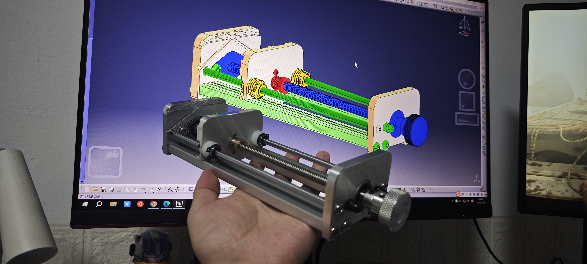
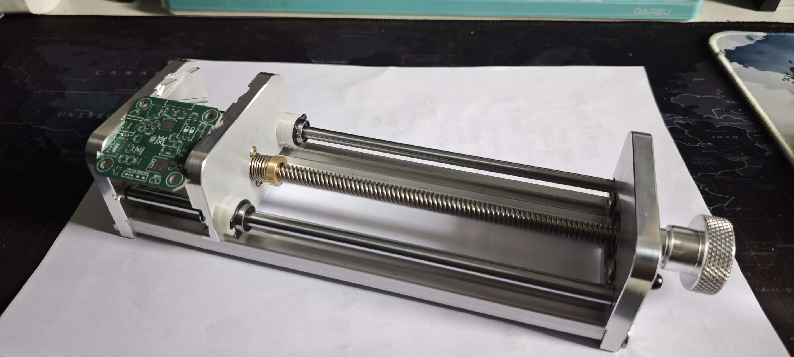
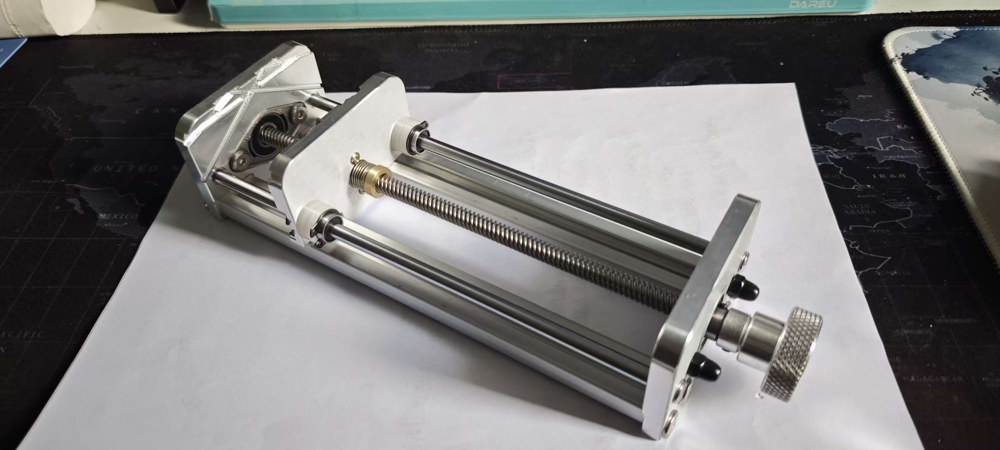
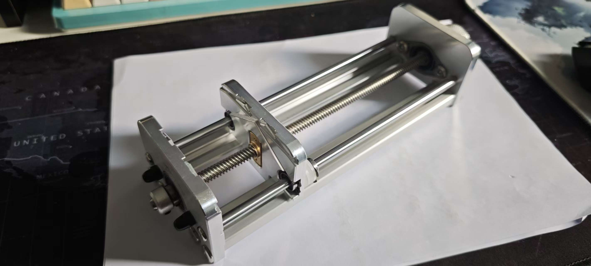

# A-PCB-fixture-clamp-tool
这是一个用于PCB固定的DIY台钳夹具，支持多角度固定，成本低廉，使用可靠。

零部件见BOM表\
STP模型见压缩包文件\
组装还需额外辅助工具：<ins>**轴用卡簧钳**以及一柄**2mm六角扳手**</ins>；\
**注意**：\
&emsp;&emsp;1.BOM中序号13的“轴向限位卡SCCAW”对应模型树中“TaiQian”-“T8-Sigan-ASY”-“Danghuan”零件，这个零件仅用于限制轴向自由度，删除并不影响使用，**卧式轴承座自带紧定螺丝**已经可以限制轴向移动；\
&emsp;&emsp;2.BOM表中1~3号零件为CNC加工件，其中1和3零件在圆头螺母位置设计之初对应的孔为螺纹孔，实际上使用通孔即可，但需要将孔径从4.2mm改为5.2mm再进行加工；

